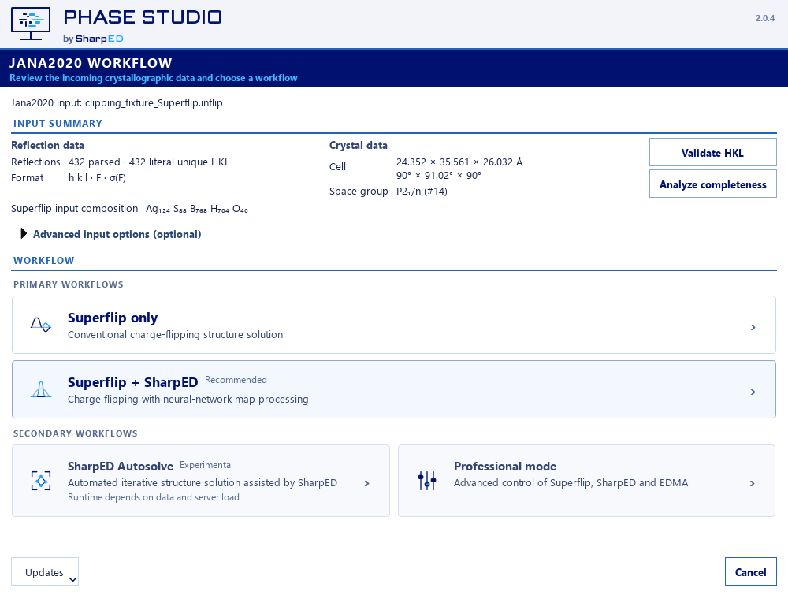

# Phase Studio

**Phase Studio** is free, open-source Windows desktop software for
crystallographic structure solution. It integrates external Superflip charge
flipping and EDMA peak extraction, optional SharpED map prediction, and
candidate-specific map/model transfer to Jana2020.

**Version 2.0.5.** [Release notes](RELEASE_NOTES_2_0_5.md) cover the refined Wizard, HKL diagnostics, UNIVERSAL Autosolve and candidate-specific viewer/handoff safeguards. 2.0.2 was the first public 2.x release; 2.0.0 and 2.0.1 were internal builds.

## Features and workflows

Version 2.0.4 adds [Sign in with Jana2020](docs/auth/SHARPED_SIGN_IN_2_0_4.md)
using browser-based OAuth code + PKCE, with the existing manual-key fallback.
See the [implementation and acceptance status](docs/auth/JANA2020_OAUTH_2_0_4.md).
Native Jana2020 handoff/overlay and physical-monitor acceptance limitations are
listed in the release notes; automated previews do not establish those checks.

- **Superflip only:** original charge flipping without SharpED access.
- **Superflip + SharpED:** iterative phasing and model prediction, retaining
  separate completed results and cycle recommendations for each source.
- **SharpED Autosolve — experimental:** guided phase search, review and refinement.
- **Professional mode:** full configuration and manual Run phasing.
- Candidate-specific EDMA, interactive `+ atoms` / `− atoms`, shared Result
  Selection, Complete-molecule and Full-cell views.
- HKL validation/completeness, optional Map Feedback, and reproducible
  project-local inputs, scientific outputs and diagnostics.



This is a reproducible offscreen UI preview, not scientific workstation acceptance.

## Standalone Windows installation

Download **PhaseStudio-2.0.5-x64.exe** from
[GitHub Releases](https://github.com/ji-ze/Phase-Studio/releases), verify it
against `SHA256SUMS.txt`, and launch it. The Windows x64 ONEFILE download
includes the Python/Qt runtime; no separate Python installation is required.
Use Windows 10 1903 or newer, or Windows 11, on x64 hardware.

Superflip and EDMA are separate programs, **not bundled or relicensed** here.
Install them from their [official distribution](https://superflip.fzu.cz/) and
configure executable paths when requested. Standalone external-HKL workflows
do not require Jana2020.

## Jana2020 integration

Jana developers can download `PhaseStudio-Jana2020-2.0.5.zip`, containing
`PhaseStudio-Jana2020-2.0.5/Phase_studio.exe` and the complete `_internal` runtime.
Keep them together. This release has no separate Jana installer and does not
replace the scientific Superflip executable.

See [developer integration](docs/JANA_DEVELOPER_INTEGRATION.md) for placement,
invocation, output protocol and acceptance checks. Jana2020 retains its own
software-license requirements.

## Jana2020 account, SharpED access key and entitlement

**Free Phase Studio software does not provide a SharpED subscription or free
inference entitlement.** SharpED is a separate hosted machine-learning service;
its server code, architecture and model weights are not distributed here.

1. Open the [SharpED token page](https://sharped.fzu.cz/sharp-ed) and sign in with
   your existing Jana2020 account if prompted. No separate SharpED account is required.
2. Accept the current SharpED service terms.
3. Obtain any subscription or access entitlement required by current policy.
4. Expand **API tokens for desktop application** using **Show**. Enter a
   **New token name** and click **Create token**.
5. Paste the access key into Phase Studio's masked **SharpED access key** field
   and choose **Connect using access key**. Phase Studio 2.0.4 remembers manual keys in
   Windows Credential Manager by default; keys are not written to QSettings.
   Uncheck **Remember access on this device** for session-only use, or use
   **Remove saved access** to explicitly delete a saved key.

The documented Public API is **https://jana.fzu.cz/**. The client uses that
single host for model discovery, authenticated upload, status and download.
Missing/expired tokens or inactive entitlements are access problems, not
scientific calculation failures. Downloads contain no personal API token.

The supplied October 2026 terms provide a temporary free preview ending
**31 October 2026 at 23:59 Europe/Prague**, with no automatic paid conversion.
This is not a permanent exemption from service fees. Later access and charges
depend on the current provider policy; Phase Studio specifies no pricing tiers.

Maps are processed remotely. HTTPS protects transmission, not plaintext from
the processing service. Keep independent copies and retrieve results promptly:
the supplied terms specify separate 60-minute input/output map-deletion timers.
Send only data you may share. See [service access and data handling](docs/SHARPED_ACCESS.md).

## Data and scientific limitations

Inputs include Jana `.inflip` projects and external HKL reflection files. Cell,
space group and composition may come from the Jana context, a reference file
or validated manual metadata. Structure views/exports use CIF/PDB; density
workflows use XPLOR maps. The [technical user guide](docs/USER_GUIDE.md) preserves
the detailed format and workflow documentation.

Validate HKL interpretation and completeness before phasing. FWHM is peak
width, not intensity uncertainty. Powder overlap repartitioning requires a
positive wavelength; zero requests automatic detection.

Predictions and EDMA peaks are candidate models, not certified structures.
Independently validate chemistry, symmetry, diffraction agreement and refinement.
Display expansion does not create independent detected sites. Lowering an
EDMA threshold can add CIF peaks while the composition-constrained Jana model
remains unchanged. Normal EDMA defaults are 0.50σ for both result families;
Autosolve has its own policy. EDMA-derived exported Uiso is converted from Biso
when necessary and bounded to 0.010–0.150 Ų.

Numerical handoff guards preserve the selected map's grid and coordinate frame.
Actual Jana GUI import, map/atom alignment and continuation still require
workstation acceptance; automated/file tests are not represented as that test.

## How to cite Phase Studio

Scientific publications reporting work performed with Phase Studio should cite
the software. This is the project's scientific-attribution policy, separate
from the standard MIT license; it adds no license restriction.

> Zelenka, Jiří. *Phase Studio*, version 2.0.5. Institute of Physics of the
> Czech Academy of Sciences. https://github.com/ji-ze/Phase-Studio

```bibtex
@software{zelenka_phase_studio_204,
  author  = {Zelenka, Jiří},
  title   = {Phase Studio},
  version = {2.0.5},
  url     = {https://github.com/ji-ze/Phase-Studio}
}
```

[CITATION.cff](CITATION.cff) enables GitHub software citation. No DOI or paper
is asserted. SharpED has separate developers, terms and any separately
published citation guidance. Cite Superflip, EDMA and Jana2020 as applicable.

## License, developers and support

Phase Studio source uses the unmodified [MIT license](LICENSE), with no
Phase Studio software-license fee. Dependencies retain their separate
licenses: [third-party notices](THIRD_PARTY_NOTICES.md).

**Author and lead developer:** Jiří Zelenka, Fyzikální ústav AV ČR, v. v. i.
(Institute of Physics of the Czech Academy of Sciences).

**SharpED developers, separately:** Jiří Zelenka, Jan Rohlíček,
Monika Kučeráková and Zdeněk Buk, at the same institute.
See [authorship and acknowledgements](AUTHORS.md).

Report reproducible problems in the
[issue tracker](https://github.com/ji-ze/Phase-Studio/issues). Remove credentials
and private scientific data before sharing diagnostics. Contact the SharpED
provider for accounts, entitlement and current service terms.

See [release packaging instructions](packaging/README_RELEASE.md) for source
builds, legal resources and manual release preparation.

Windows update signing, migration and activation requirements: [maintainer guide](docs/WINDOWS_UPDATES.md). Production deployment requires reviewed builds and native acceptance; a pinned public key alone is not production-readiness evidence.
