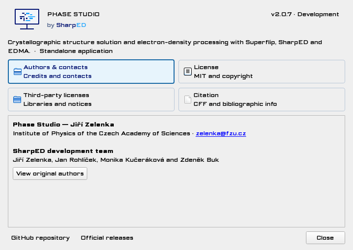
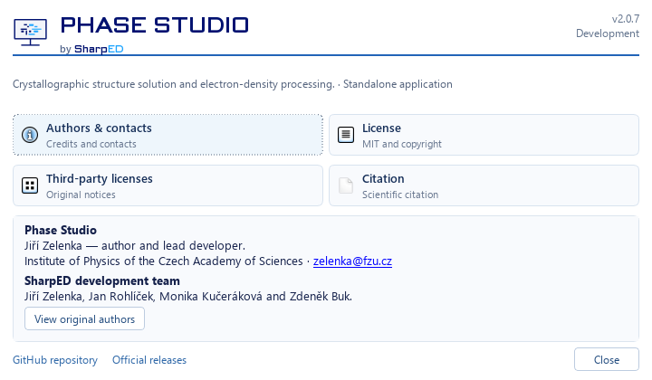
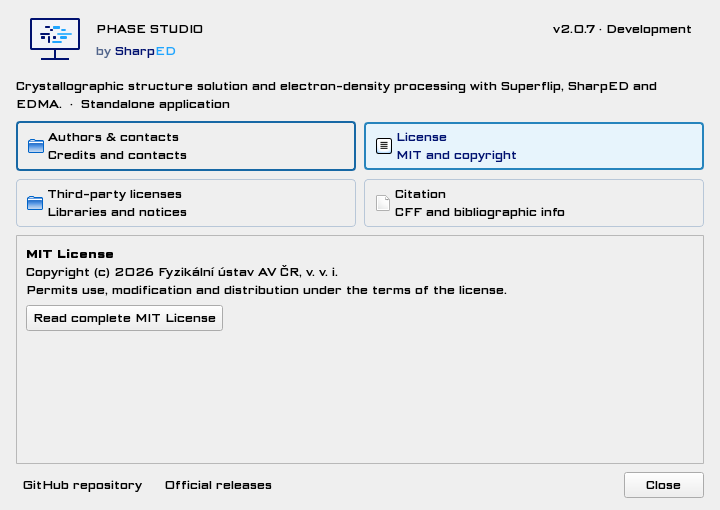
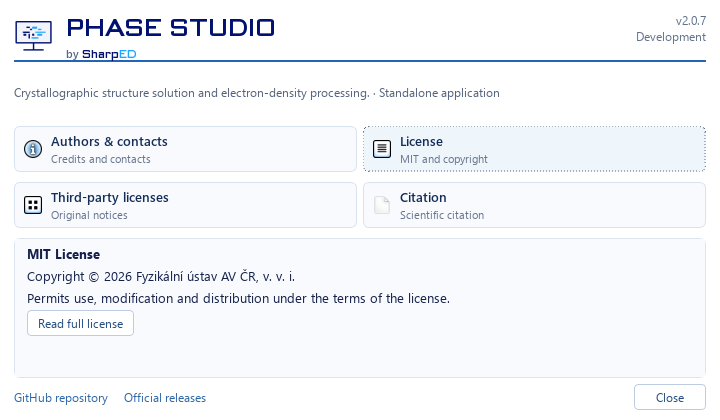
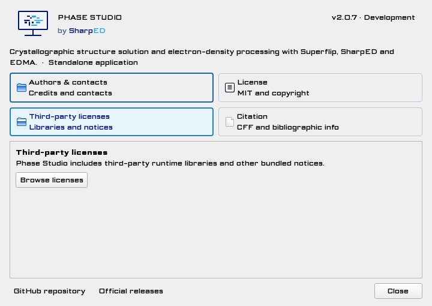
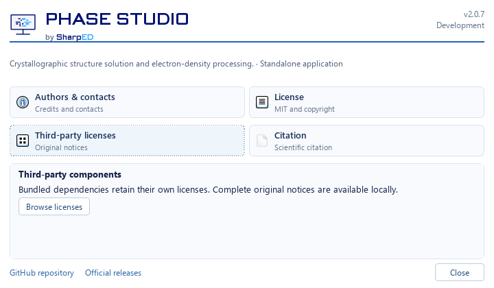
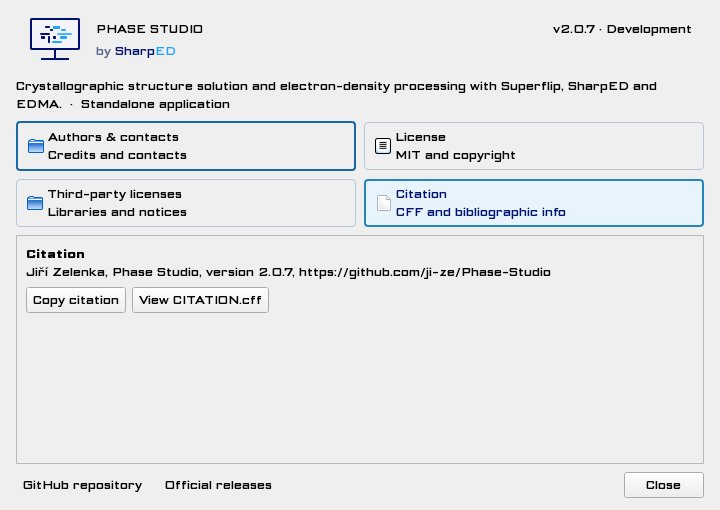
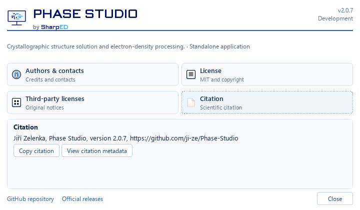
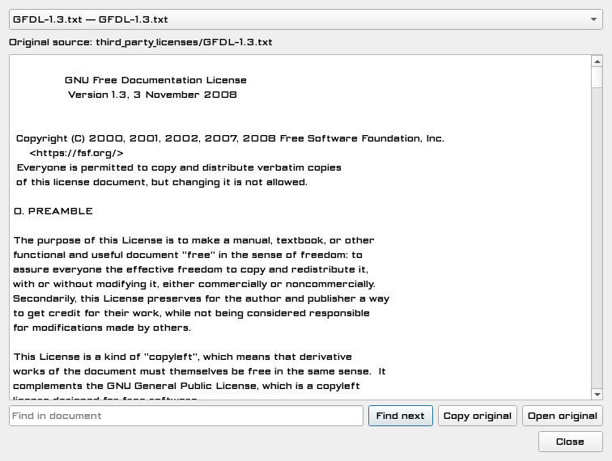
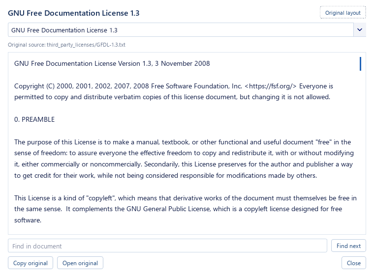

# About UI correction for Phase Studio 2.0.7

The four-card About dialog now uses a readable standard UI face, a compact 720 × 420 logical-pixel layout, and a reusable document reader. The scientific dashboard, update security, legal resource bytes, version and branding font loader are unchanged by this correction.

The font defect was a fallback problem, not a deliberate global Science Gothic stylesheet rule. The Windows offscreen Qt backend enumerated **zero system fonts**. Loading the wordmark then registered only Science Gothic, so `QFontInfo(QFont("Segoe UI", 10)).family()` resolved to **Science Gothic**. The existing style bootstrap only loaded system fonts when the database was completely empty; standalone About captures bypassed that bootstrap. The shared resolver now registers installed Segoe UI font bytes when that family is missing, even after branding was loaded. Native Windows uses its installed font database. No proprietary system fonts are redistributed.

Shown and polished widgets resolve to **Segoe UI** for ordinary UI text and **Segoe UI 10.5 pt / normal** for document text. The wordmark resolves to **Science Gothic 18 pt / normal**. The existing Unicode-safe Science Gothic byte loader is retained. Reader switching also clears QTextEdit's retained current character format, preventing a Markdown heading from turning the next plain-text license into large bold text.

| Defect | Correction and verification |
| --- | --- |
| Blocky paragraph/control font | Effective QFontInfo checks after show, including branding-first and unstyled initialization |
| Oversized grey panel | 720 × 420 preferred size; restrained 140 px shared panel; no page stretch spacer |
| Two apparently selected cards | Exactly one checked card; selected pale cyan fill; keyboard focus uses a neutral dashed border |
| Unrelated folder icons | Small native information/document/list glyphs, no folder artwork |
| Debug-like license chooser | Friendly titles, actual package/version metadata where bundled, full relative source path in tooltip/accessibility metadata |
| Narrow legal text column | 10.5 pt proportional text and paragraph reflow; Original layout restores source line breaks |
| Legal original integrity | Exact original bytes retained, raw source copy/open, safe Markdown and blocked embedded resource loads |
| Citation drift | Author names and metadata read from CFF rather than duplicated in presentation code |
| Short/narrow displays | 452 × 420 on a 480 × 520 fixture; 604 × 345 on a 640 × 360 fixture; content scrolls and Close stays visible |

Both profiles have the same four cards and stable outer geometry. Search, copy, opening originals, Escape, one modal per owner and safe explicit HTTPS/mailto links remain available. Reflow changes display whitespace only; complete original bytes remain intact and are available through Copy original, Open original and Original layout.

Isolated build inputs preserve the original legal baseline bytes explicitly; a fresh Windows checkout's automatic CRLF conversion must not silently change the packaged resource hashes. Raw-copy regressions compare original bytes directly rather than assuming a particular checkout newline convention.

Focused verification: **23 passed**. This includes all four Qt scale factors (1, 1.25, 1.5, 2), source access and Unicode/extended paths, existing branding path tests, application-menu/About ownership checks and update UI regressions. Eleven legal authority hashes match the preserved local baseline, including LICENSE, AUTHORS.md, CITATION.cff, THIRD_PARTY_NOTICES.md, bundled upstream texts and the Science Gothic OFL. Complete exact-source regression and frozen artifact evidence are recorded in draft [PR #21](https://github.com/ji-ze/Phase-Studio/pull/21) and the local `build/about207-correction/` evidence directory; focused results are not a substitute for those gates.

The screenshots below are **actual Qt widgets** with public About/legal content. Offscreen images use controlled screen geometry; the native Windows image is also a controlled fixture. Neither establishes human physical/mixed-DPI acceptance. No scientific inference was run.

| View | Before: rejected implementation | After: corrected implementation |
| --- | --- | --- |
| Authors |  |  |
| License |  |  |
| Third party |  |  |
| Citation |  |  |
| Reader |  |  |

Additional inspected captures: [MIT reader](screenshots/about207-correction/after/mit-viewer.png), [keyboard focus versus selection](screenshots/about207-correction/after/focus-versus-selection.png), [narrow content scrolled to its action](screenshots/about207-correction/after/narrow.png), [short screen](screenshots/about207-correction/after/short-screen.png), [200% offscreen](screenshots/about207-correction/after/authors-200pct.png), [native Windows backend](screenshots/about207-correction/after/native-windows.png).

The broader unfinished main-window and update changes remain in their original working tree and are excluded from this About correction commit. PR #21 remains draft; this work does not authorize merge, tag, production signing or release.
