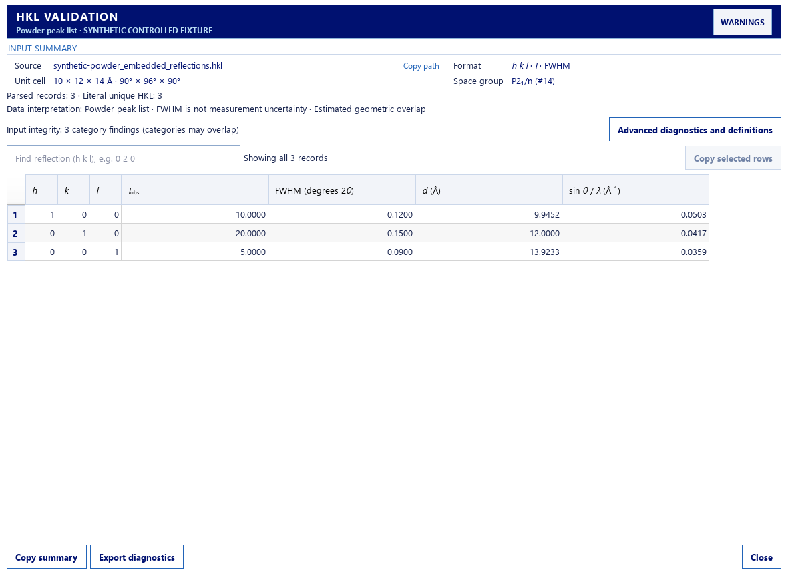
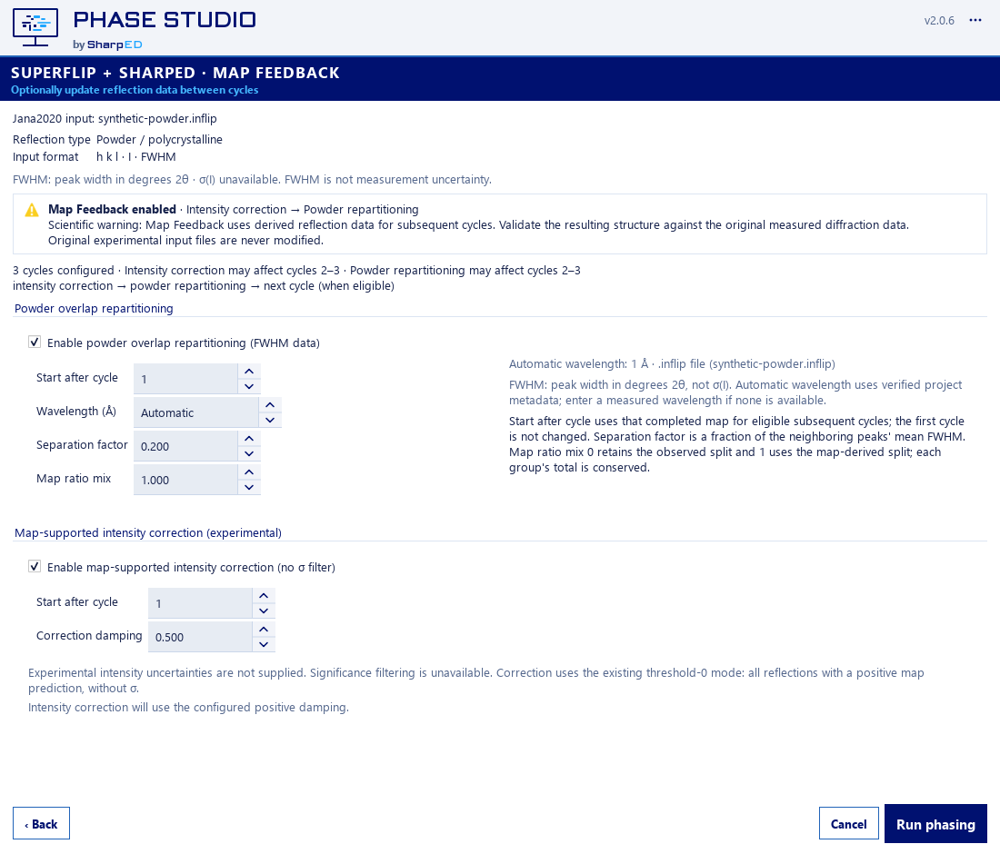

# Phase Studio 2.0.6 — final RC acceptance

Date: 2026-10-21. Status: automated RC acceptance passed; production release
approval remains conditional on the manual gates below. This is not a published
release. No commit, push, merge, tag, signing or publication was performed.

This paragraph and the source-state description below record the RC acceptance
point. Subsequent authorized Git integration is recorded separately in
`RELEASE_INTEGRATION_2_0_6.md`; it does not retroactively change these test results.

## Source identity and included work

Branch: `release/2.0.6-rc`. Base commit:
`b628eb9da8b66f9b91b34ab87a6d67eebf0da78c`. The accepted EDMA, OAuth and
Map Feedback corrections are still in the working tree, not in that commit.
Canonical application version remains **2.0.6**.

Both distributions were built from the same immutable `build/fc26` snapshot.
Its complete file hashes, dirty status and dependency versions are recorded in
`build/final206-consolidated/source-snapshot.json`, SHA-256:
`35d676bef8bd407703bd7c338a78e4720d2f46d47db3848274151f4a8b55aee8`.
All recorded source hashes were rechecked. This acceptance report is a
post-build, non-runtime document; it was not injected into the frozen snapshot.

Changes since v2.0.5 include the application menu, Wizard navigation/status/About,
responsive HKL diagnostics and full-precision table interactions, fitted result
viewers and Qt ownership fixes, EDMA scientific protocol/provenance correction,
signed updater and both packaging profiles. The final working-tree changes add:

- Reliable repeated EDMA threshold review, short Windows workspaces, preserved
  failure diagnostics, validated CIF/model identity and safe candidate replacement.
- Automatic current-user Windows Credential Manager OAuth persistence, bounded
  expiry restoration, synchronized authentication and separate manual-key storage.
- Consistent positive Map Feedback I/σ(I) limits in both GUI paths. Amplitude
  input uses the documented first-order estimate F/(2σ(F)); zero bypasses the
  filter, including map-supported zero observations. No settings migration occurs.
- Frozen acceptance coverage for that threshold calculation and cross-process
  logout preserving a manual key. The final consolidation also corrects the
  zero-limit explanatory note; it does not change its calculation.

Production files changed in the combined working tree: `app.py`, `credentials.py`,
`error_reporting.py`, `jana_superflip.py`, `oauth.py`, `oauth_diagnostics.py`,
`oauth_ui.py`, `packaging_acceptance.py`, `result_selection.py`, `review_edma.py`,
`sharped_access.py`, `sharped_server_client.py`, and new `edma_acceptance.py`, all
under `phase_studio/`. Supporting regression tests and Map Feedback documentation
are included. The snapshot inventory is the exact file-level authority.
No 2.0.7 functionality was added or existing work discarded/stashed.

## Fresh source validation

Logs are in `build/final206/`; historical counts were not reused.

| Check | Fresh result |
| --- | --- |
| Complete pytest suite | **625 passed, 4 skipped, 37 subtests passed**, 549.50 s |
| OAuth persistence + pinned scientific-function guard, pre-freeze | 27 passed |
| Map Feedback focused rerun after final note correction | 21 passed, 1 skipped, 5 subtests passed |
| Scientific core/golden script | 46 checks passed |
| Jana completion | 195 checks passed |
| Autosolve orchestration | 79 checks passed |
| Workflow states | 141 checks passed |
| Result Selection viewer | 72 checks passed |
| EDMA review | 20 checks passed |
| Displacement parameters | 42 checks passed |
| Fullscreen viewer script | Passed, exit 0 |
| Source saved-map native EDMA | 10 adjustments; 171 original files unchanged |
| Source packaging/GUI probe | Passed |
| `git diff --check` | Passed; only Git line-ending advisories |

The four skips are the opt-in real-project test and inapplicable ONEFILE/ONEDIR
transaction parameter combinations, not waived failures. Real saved-map EDMA
was exercised separately. The full suite began before the final explanatory
note edit; the affected focused tests and final frozen checks ran after it.
No scientific production code changed after the snapshot.

Scientific guards preserve existing golden expectations and export contracts.
The pinned AST guard permits only the intentional positive significance-gate
change. Corrected EDMA peak interpretation is not falsely described as byte
equivalence with historical incorrect structural exports. Native peak density
and charge are not ADPs; unknown ADPs remain absent. Genuine physical Uiso is
converted once and bounded to 0.010–0.150 Ų by the existing export authority.

## Fresh distributions and frozen acceptance

Output root (all paths below relative to the repository):
`dist/optimization-2.0.6/final206-consolidated/combined-safe/`.

| Deliverable beneath output root | Bytes | SHA-256 |
| --- | ---: | --- |
| `release/PhaseStudio-2.0.6-x64.exe` | 93987120 | `ed290b18cb9c0cc11f80585e5b09a0ce8c6aad79a9585a9e5e11ef4ce7252c3b` |
| `release/PhaseStudio-Jana2020-2.0.6.zip` | 92631947 | `de99f3eef834c086ec962feed8727030faa99f05755867f17007cfa88256dabd` |

The complete `PhaseStudio-Jana2020-2.0.6/` directory is retained: 407 files,
406 in `_internal`, 202197354 bytes total. Keep the entire directory together.
Manifest: `build/final206/SHA256SUMS.txt`; machine-readable values and sizes:
`build/final206/deliverables.json`. Older RC outputs were not overwritten.

Python 3.12.13; PyInstaller 6.20.0; PySide6 6.11.1; numpy 2.5.3;
matplotlib 3.11.1; gemmi 0.7.5; cryptography 50.0.2.
Supported `packaging/build_windows.ps1 -Target All` was invoked inside the
snapshot through the existing `combined-safe` packaging driver.

Fresh final-binary evidence:

- Both profiles start with version 2.0.6. Native Windows GUI probes, three
  offscreen DPI scales (100/125/150%) per profile and five warm starts pass.
- All four supported uncertainty formats exercise the real threshold function
  through both GUI settings paths: 16 positive-gate comparisons per GUI probe,
  strict boundary behavior, amplitude approximation, zero bypass and FWHM rejection.
- Eight independent synthetic WinCred process phases plus cleanup pass across
  the two EXEs. Explicit OAuth logout retains a separate manual key. Production
  credentials were not read or used by these isolated credential diagnostics.
- Each final EXE performs ten real native EDMA threshold adjustments on a copy
  of the saved five-cycle JD559H project. Selected cycle/source, map hashes,
  corresponding model hashes and valid CIFs remain consistent. All 171 original
  project files remain unchanged. SharpED cycle 3 has 17 CIF / 24 native Jana
  sites; Superflip thresholds 0.3/0.4/0.5/0.6 have 29/28/27/25 CIF sites and
  18 native Jana sites. These are distinct scientific representations.
- Fifteen modules in each final EXE match compiled current source, including
  all changed EDMA/OAuth/Map Feedback modules, canonical version and updater trust.
- Native dependency audit: 107 PE files, zero blocking problems, zero conflicting
  DLL names, zero unresolved non-Windows dependencies. ICU requires Windows
  10 1903+ as documented. No runtime dependency on development host paths was found.
- The complete 407-file ZIP is extracted, inventory/hash verified, and its
  extracted executable starts successfully. Independent updater helper and
  both applications have identical pinned trust configuration.

Details: `build/final206-consolidated/combined-safe/metrics.json`, `build.log`,
`frozen-updater.log`; `build/final206/frozen-oauth.json`, `frozen-code.json`,
`frozen-edma-standalone/report.json`, `frozen-edma-jana/report.json`.

## Updater, visual evidence and preservation

Actual new ONEDIR package transactions pass installation/restart, controlled
startup-failure rollback and interrupted recovery in disposable `build/uf26/`.
Scientific/unrelated sentinels survive. The successful installation encountered
one Windows access-denied error (5); verified rollback restored the old runtime,
then the explicit retry succeeded. This observation is retained in
`build/uf26/acceptance.json`, not presented as first-attempt success.
These same-version transaction fixtures do not constitute a public upgrade or
production signature test. Strict version and fail-closed signature checks are
covered by the complete regression suite. The harness's final legacy message
about public installation being disabled is not a statement of current key
configuration: the production public key is already pinned.

Pinned key ID `1c016867382d60e0`, canonical version and Windows release workflow
are unchanged from HEAD (Git line endings normalized for comparison). No key
generation, production signing, Secrets or workflow changes occurred.

Actual frozen Qt screenshots are under each native/DPI acceptance directory in
`build/final206-consolidated/combined-safe/`. Native full-size Map Feedback
screens and contact sheets of both native profiles plus representative 125/150%
offscreen runs were inspected. Contact sheets: `build/final206/*-contact.jpg`.
These are rendered application images, not mockups or physical-monitor approval.
The automated probe directly selects the Map Feedback page; its navigation
caption is a diagnostic setup artifact, not a tested full Wizard click sequence.

All 41 workshop files retain their pre-build hashes, recorded in
`build/final206/workshop-before.json`. Historical images/PDFs were not regenerated.
Older `feedback-single-crystal.png` / `standalone-map-feedback.png` illustrations
and derivative tutorial PDFs may show obsolete F/σ(F) or value/σ labels; the new
I/σ(I) documentation supersedes those visuals. No original user datasets or
scientific outputs were rewritten. No paid inference was submitted.

## Remaining approval gates

1. Interactive Jana2020 launch → selected workflow → returned map/model →
   acceptance/refinement on the final binaries. Automated handoff/state guards
   pass; an actual Jana import/refinement session was not performed here.
2. Live browser login followed by repeated new-process calculations without
   renewed login while the grant is valid. Synthetic persistence passes; no
   production credentials or paid API job was used for this consolidation.
3. Physical-monitor usability, non-admin/UAC and Windows restart acceptance.
   Native automated rendering and current-user credential persistence do not
   substitute for these manual checks.
4. Approved reviewed-source integration, non-public production-key signing run,
   and verification of the `phase-studio-release-publication` environment and
   protection rules before publication. These were not executed or freshly
   verified in this task. PR #14/#15 and remote branch status were not changed.

OAuth grants expire according to the server (at most one hour currently), with
a 60-second safety margin. Reauthentication after expiry is expected; no refresh
grant is invented. Windows credential availability/size limits can cause warned
session-only storage. Amplitude-derived significance is a first-order estimate,
especially limited for weak data; no FWHM-to-uncertainty substitution is allowed.

**Ready for automated RC review: yes. Ready for unconditional production release
approval: no, pending the explicit manual and production-signing gates above.**

## Final embedded-HKL / Map Feedback correction (2026-10-21)

This addendum records the final scientific correction on top of the earlier RC
snapshot without changing its historical measurements. The application version
remains **2.0.6**. The source correction reads embedded Jana reflection columns
through strict verified-layout validation for the shared HKL diagnostic result,
Wizard Map Feedback, and effective run configuration. Stale legacy
`reflection_data_mode` state cannot turn declared `I + FWHM` into an
uncertainty-bearing format. Unsupported or ambiguous declared layouts stop
before Map Feedback execution.

For powder `I + FWHM`, the Wizard reports powder and the declared columns,
explains that FWHM is peak width rather than measurement uncertainty, disables
the positive I/sigma filter, and exposes the existing experimental
map-supported correction with threshold zero. Existing start-cycle and damping
controls and powder-overlap requirements are preserved. Genuine `I + sigma(I)`
and `F + sigma(F)` retain their existing measured/first-order significance
behavior. Synthetic backend regressions verify FWHM rejection by positive
thresholds, threshold-zero behavior, damping behavior, cycle handoff and source
file immutability. The accepted calculations were not changed.

The requested `7720677_Superflip.inflip` was not present in this workspace. The
available real `ochlor_Superflip.inflip` was used as a representative project:
631 records parsed; its original bytes and SHA-256 remained unchanged, and the
parser reports verified powder `h k l / I / FWHM` columns with no significance
statistic. No real experimental map was available, so a map-derived correction
or output HKL for that project was not claimed. Synthetic map fixtures exercise
the calculation and serialization path.

Actual Qt evidence (not mockups) is stored locally under ignored `build/`:

- `build/acceptance-map-feedback-2.0.6/hkl-validation-ochlor.png` ? HKL
  Validation for the real available input.
- `build/map-feedback-2.0.3/scale-1.25/01-powder-one-cycle.png` ? Wizard
  classification and the disabled one-cycle state using that input.
- `build/map-feedback-2.0.3/scale-1.25/06-both-enabled.png` ? Wizard powder
  controls and no-sigma map correction with three cycles and verified project
  wavelength metadata.
- The same folder contains actual intensity-sigma and amplitude-sigma control
  screenshots; both retain their respective significance controls.

Visual inspection confirmed agreement between the HKL Validation and Wizard:
`Powder / polycrystalline`, `h k l / I / FWHM`, no measured sigma. The 125%
Wizard screenshot scrolls to the controls because the enabled panel is taller
than the fixed capture window; the dialog remains scrollable. The real ochlor
screenshots and scientific input copies remain untracked under ignored
`build/`; the synthetic control screenshots below are included for reviewers.

The committed screenshots below are actual Qt renderings of a clearly labeled
synthetic three-reflection control fixture. They show the shared classification
and the enabled zero-sigma-filter path with positive damping; they do not claim
to depict the unavailable 1,466-record target project or a real map correction.
The user-supplied before-state is recorded above; its input file was unavailable
for a reproducible before screenshot.

Final local verification after the correction:

| Check | Result |
| --- | --- |
| Complete pytest suite, excluding two OS-bound tests unavailable under this local sandbox | **627 passed, 4 skipped, 2 deselected, 37 subtests passed** |
| Earlier unfiltered pytest | 625 passed, 4 skipped, 3 failed: two Windows Credential Manager / directory-handle checks blocked by this sandbox, and one powder-layout diagnostic wording regression that was fixed and passed in the focused rerun |
| Focused Map Feedback + scientific AST baseline + Powder Diagnostics + Wizard navigation | **35 passed, 1 skipped, 5 subtests passed** |
| Real available ochlor embedded-input/UI check | **1 passed**; no map was supplied |
| Scientific core standalone acceptance | **46 checks passed** |
| Jana completion/handoff standalone acceptance | **195 checks passed** |
| Workflow-state standalone acceptance | **141 checks passed** |
| Result Selection/viewer standalone acceptance | **72 checks passed** |
| EDMA review standalone acceptance | **20 checks passed** |
| Fullscreen viewer standalone acceptance | Passed |
| Actual Qt Map Feedback screenshot capture | Passed; 8 scenarios report powder `I + FWHM` with sigma unavailable, plus valid intensity/amplitude sigma controls |

The two deselected tests are `test_independent_windows_processes_share_secure_grant`
and `test_inputs_cannot_be_modified_or_deleted_while_guarded`. This environment
returns Windows access denied for Credential Manager writes and attempts to open
profile-ancestor directory handles; an elevated local retry could not initialize
pytest's profile temp directory. They must pass on the hosted Windows release
runner before signing. A CI failure is a release blocker, not a waived test.

At this addendum, the scientific changes are locally tested but are not yet
committed, merged, signed or published. The official Windows workflow, final
signed packages, protected publication environment, and public `v2.0.6` release
remain pending. Manual Jana2020 import/refinement, repeated live browser OAuth,
physical monitor, Windows restart and non-admin/UAC checks are still outstanding.
