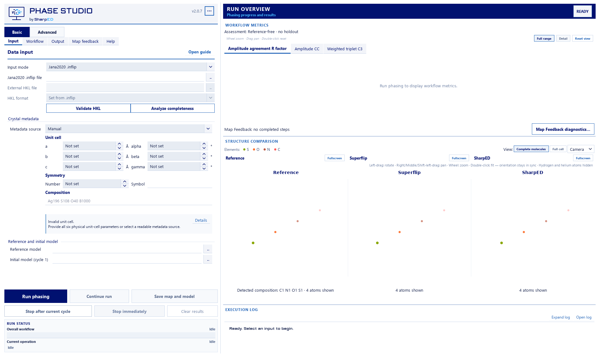
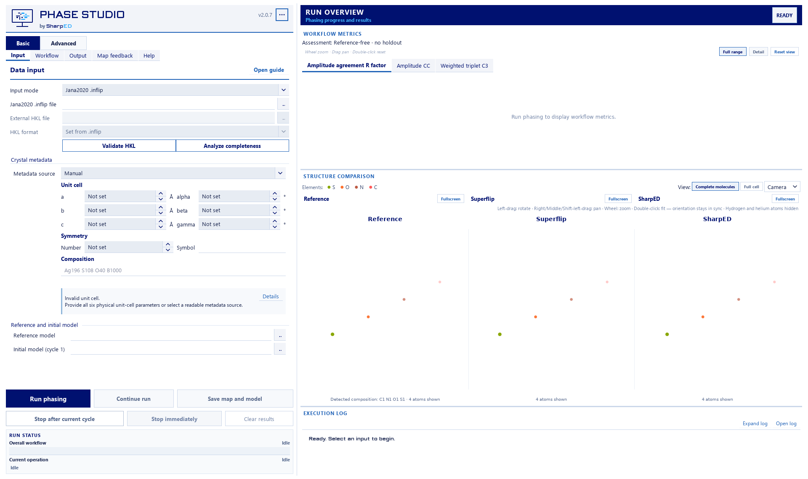

# Palette, metadata and Map Feedback review - 2.0.7

Development work for [draft PR 21](https://github.com/ji-ze/Phase-Studio/pull/21); no release publication. This supplements, rather than replaces, [the GUI audit](GUI_UX_AUDIT_2_0_7.md) and [the reference investigation](SELEXIPAG_REFERENCE_REVIEW_2_0_7.md).

## Palette root cause and affected views

The main comparison had no palette-refresh callback. Other views rebuilt scenes or retained scatter/depth-shading color caches. Menu state could therefore change while rendered atoms did not. Creating another camera menu could also reload an older setting over the live application palette.

Palette changes now reach child widgets as well as top-level windows. Tagged Matplotlib scatter artists are recolored in place, including cached depth colors and secondary translucent atoms. Legends follow the same palette. No CIF reload, scene reconstruction or camera reset is required. Newly opened menus retain the live palette; a separate application process verifies the saved preference.

Affected viewers: the three main Reference/Superflip/SharpED panels; the three Auto Solve comparison panels and their secondary atoms; detached/fullscreen structure viewers; and result-selection structure previews. Both molecular and full-cell render paths carry element tags.

Actual Qt action tests cover three main panels, three Auto Solve panels (including full-cell and molecular rendering plus secondary layers), three detached panels and the selector. They inspect nonempty Matplotlib artists before/after, assert changed authoritative colors, retained artist identities, camera limits/orientation/roll and selection. They exercise repeated changes, a controlled running state, newly rendered results, new menus and a separate process restart. The controlled running state does not start scientific execution.

## Metadata

Each panel owns a Qt label constrained to its column and three lines. Wrapping and ellipsis prevent neighboring-panel overlap; complete scientific text remains available in tooltips and accessible names. The empty footer band is hidden. Candidate metadata receives the same bound. Displayed atoms, EDMA sites and chemical composition retain their distinct meanings.

## Existing and new diagnostics

Existing `metrics.csv` and engine mean percentages remain unchanged, including their target-cycle attribution. The legacy chart can show intensity correction and powder redistribution together. These percentages describe feedback activity, not solution quality.

New diagnostics are separate from quality/ranking: a compact workflow summary opens source-cycle history, operation summaries, a cycle chart and a sortable reflection table. Missing-reflection completion, intensity correction and powder overlap repartitioning have separate status/count/statistics. Reports distinguish Disabled, Not yet reached, Not eligible, No numerical change, Applied, Unavailable and Scientific error. No later-cycle values are invented.

Read-only observations capture actual arrays at each authoritative operation boundary, so simultaneous operations compare their own input/output. The original numerical function bodies are AST-identical after removal of exactly the validated observation calls. Observer failures cannot alter scientific values. Per-cycle JSON is persisted atomically under `feedback_diagnostics/`; completed runs can be reopened and exported as strict JSON or full-precision CSV. Old runs without these files explicitly report unavailable history.

Counts/deltas describe operation arrays before the existing next-cycle file filter. Reports also record the actual written file path and count. A missing filtered record is never interpreted as zero intensity.

## Metric definitions

For matched HKL identities, delta I = I_after - I_before; absolute change is |delta I|. Inputs are the actual stage inputs, possibly already derived from earlier feedback, rather than necessarily original measurements. Amplitude modes use the existing authoritative intensity conversion. Negative intensity inputs remain negative; nonfinite values and overflow are unavailable.

Changed records fail `isclose(rtol=1e-12, atol=1e-12)`. Mean/median/maximum absolute change use changed, finite matched records. Mean absolute relative percentage is the arithmetic mean of `100|delta I|/I_before` for changed finite records with `I_before > 1e-12`. Empty populations are unavailable, not fabricated zero means. Relative population is reported explicitly.

Legacy intensity mean includes map-supported corrected records with positive input, including unchanged records. Legacy powder mean is the unweighted mean of group means of member absolute relative percentages, including unchanged eligible members; groups without a denominator are omitted. Consequently these legacy percentages need not equal the new reflection-weighted changed-population mean.

Completion reports proposed and actually added reflection counts and `100 * added / input count`. Newly added HKLs have no measured before intensity; a relative correction is unavailable. Powder reports detected/eligible/modified group counts and modified/unchanged eligible reflections.

Conservation uses actual per-group stage sums computed with `math.fsum`; tolerance is `rtol=1e-12, atol=1e-9`. Nonfinite or missing members make that group's check unavailable. Failed conservation is surfaced as a scientific error without correcting or hiding the values.

## Verification against the recorded Selexipag run

Only existing local maps and reflection files were used; no new SharpED inference was started. A deterministic replay applies the unchanged authoritative powder operation to the initial 4,690 reflections and the recorded deblurred maps, feeding full returned arrays forward. This reconstructs the stage arrays; it does not claim historical in-memory snapshots existed.

For all 20 transitions after cycles 5-24, all 88,462 persisted next-cycle reflection values match their reconstructed HKL values within 5.1e-8, consistent with the existing seven-decimal writer. Maximum observed error is 4.9997705531268366e-8. Legacy percentages exactly match the corresponding target-cycle entries in the recorded metrics. Independent group-sum checks have maximum error 4.547473508864641e-13.

After cycle 5 -> input cycle 6: 3,795 eligible and 3,718 modified reflections, 77 unchanged eligible; 794 detected groups, 768 modified groups. Mean/median/max |delta I| are 25.747922698610772 / 10.450399766393065 / 1353.1598122680912. The new changed-reflection relative mean is 1707.9603909333075%; the legacy group mean is 677.838443747827%. The different denominators explain this difference. The next-cycle file contains 4,428 records after the unchanged writer filter.

Controlled fixtures additionally exercise simultaneous methods, completion, no map signal, zero/missing significance, zero damping, missing wavelength, unavailable groups, negative/zero/nonfinite values, strict export and stage-relative conservation.

## Visual evidence and limitations

The user's November 1 screenshots are now located in the local Screenshots folder. The 16:40:45 capture directly demonstrates overlapping comparison metadata; palette-menu captures document the reported interaction. The Input capture and later validation capture show different input paths, so their metadata cannot establish a same-session execution inconsistency.

Private evidence remains in ignored `build/palette-feedback207/`: `comparison.html` links actual paired Qt captures from baseline 2aa74fa and the revised source, the operation summary/chart/reflection table, and 100/125/150/200% scale captures. `artist-colors.json` proves the baseline artists stayed unchanged while the corrected artists change. The captures use existing recorded models and identify diagnostics as recorded replay. Coordinates, reflection rows, maps and user screenshots are not committed.

The isolated label tests pass empty/short/long strings at all four scales. Whole-window captures still expose the pre-existing minimum-width/vertical-space clipping at a 1920x1140 physical viewport at 200%; this is not claimed fixed. Physical mixed-monitor migration remains unverified. Wavelength source-priority policy remains the earlier audit's open decision. The reference molecular view correctly retains both independent 35-heavy-site molecules (Z-prime=2); it is not a chemically validated single-molecule selector.

## Regression and integration

Initial complete native suite: 643 passed, 4 skipped, 37 subtests passed. Latest focused palette, diagnostics, restart/export and four-scale UI suite: 6 passed. The expanded Auto Solve/secondary-layer palette test also passes separately. Final complete suite: **644 passed, 4 skipped, 37 subtests passed in 605.82 s** (`build/feedback207-native-final-full.txt`). Final focused suite: **6 passed in 8.59 s**, including the expanded Auto Solve palette coverage. The complete suite uses workspace-local TEMP/TMP and `--basetemp` because the shared Windows pytest temporary directory is inaccessible; no tests were excluded. The four existing conditional skips remain unchanged. All eight existing authorities pass: scientific core 46, Jana completion 195, Auto Solve orchestration 79, workflow states 141, result selection 72, EDMA review 20, displacement 42 and fullscreen exit 0. The selection authority now reads complete accessible Qt label text instead of the removed Matplotlib text objects; its formula-isolation assertions are retained. Existing numerical regression authorities remain intact; their guards permit only the precisely validated read-only observations.

The published 2.0.6 tag/artifacts are untouched. No signing configuration, SignPath files, release upload or production inference is changed. Pre-existing untracked `docs/workshop/` remains outside this work.

### Public synthetic capture pairs

These actual Qt captures use four generated C/N/O/S atoms and contain no user project data. The same CPK menu action leaves baseline atoms unchanged and recolors revised atoms. The saved [artist colors](screenshots/2.0.7-palette-feedback/artist-colors.json) independently confirm the visible result.

| Baseline | Revised |
| --- | --- |
|  |  |
|  |  |

### Reproduce the recorded-run check

The checked-in read-only verifier accepts explicit recorded settings and writes only outside the input run. For the supplied run:

```powershell
python packaging/tools/verify_recorded_feedback_207.py <run_0001> --output build/palette-feedback207/real-replay-final --wavelength .39986 --cycles 25 --start 5 --separation .2 --mix 1
```

It hashes maps, next-cycle files, initial reflections, reference and metrics; verifies group sums independently from captured reflection rows; and saves verification results and per-cycle reports. It runs existing local feedback mathematics against saved maps, never launches Superflip or SharpED. The preset format is this application's recorded intensity/FWHM powder run; it is not a general reconstruction of arbitrary missing-feedback histories.

### Final isolated Windows package checks

Both combined-safe profiles pass native dependency/distribution audits; the Jana ZIP passes extraction and verification of 407 files. Both final frozen application acceptance reports have `ok: true`, version 2.0.7 and unchanged controlled inputs. Every runtime Python source file matches the isolated build snapshot. These are unsigned local development artifacts, not published releases.

- ONEFILE SHA-256: `940ccd314fd8d6e89f2e8c610ee6df6f0ad24ac7ecbc860fb08156e2c335aca3`.
- Jana ZIP SHA-256: `c83011b736421783608851b03fc7eff09088070892dd8b95ce35797607ee2086`.
- Logs: ignored `build/feedback207-build-final.txt`, `build/feedback207-frozen-final-*.txt`; reports under `build/palette-feedback207/frozen-final-*`.
