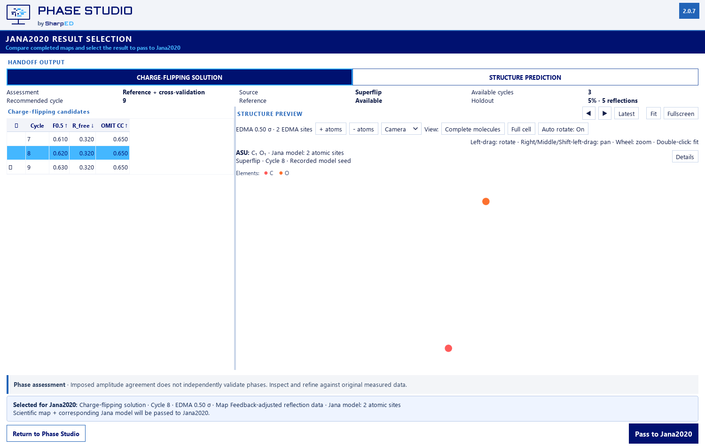
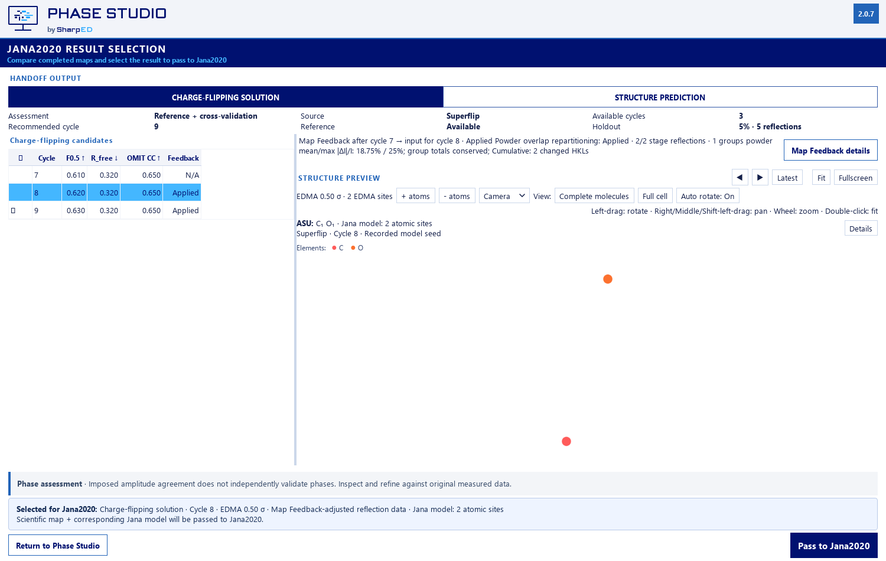
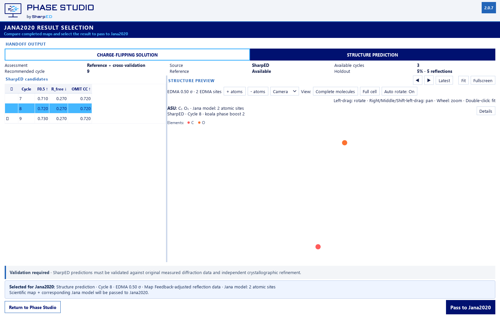
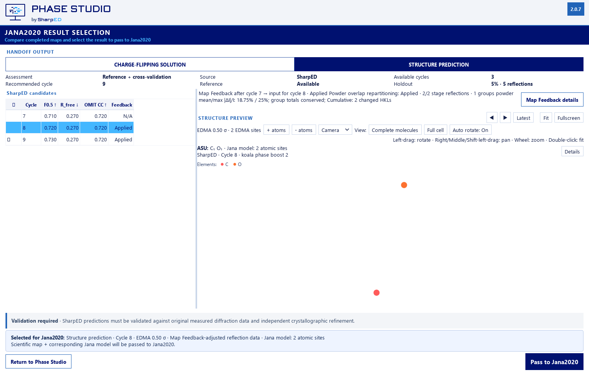

# Result Selection input diagnostics - 2.0.7

The previous selector gated `Feedback delta` on intensity correction and read only `CycleResult.intensity_correction_avg_change_percent`. Powder-only feedback therefore disappeared. Its generic provenance label did not identify the preceding operation or distinguish original observations from the actual written cycle input.

The selector now reads the same persisted per-cycle records as Run Overview, completed-run review and diagnostic exports. Its compact Feedback status covers powder-only, intensity-only and combined methods; full numeric information is available in the selected-candidate summary tooltip and the shared details dialog. Historical intensity and powder-group means remain separately labelled in table tooltips. A historical mean alone cannot establish detailed counts or a before/after history; the status is explicitly N/A rather than fabricated zero.

## Provenance and numerical authority

For candidate cycle N, the selected operation record must have source N-1 and target N. Changes after N belong to input N+1. Both result families share cycle-level reflection lineage: Superflip consumes that input and SharpED consumes the resulting Superflip map. This is established by the pipeline, not by copying one family's quality metrics. EDMA threshold changes update the model selection independently and never change reflection history.

For new calculations an original-observation snapshot is persisted before holdout and output filtering. Each completed cycle records the actual input-file path and SHA-256, its cumulative difference against those original observations, and the next written input. A separate net comparison of consecutive written inputs includes all feedback methods, filtering and file rounding. Operation records retain their own pre-filter stage arrays. These populations are explicitly distinct.

All differences reuse `feedback_diagnostics.compare_stage`; the scientific processing and recommendation functions are unchanged. The existing positive-denominator policy, finite/duplicate guards and tolerances are preserved. Signed relative delta is `100 * delta I / I_before`, for the same finite positive input population as the absolute percentage. Mean and maximum absolute relative percentages share that population. Empty populations are unavailable. Added or absent HKLs never imply zero intensities.

The shared dialog provides operation summaries, per-operation reflection changes, a cumulative input-versus-original table and an actual consecutive-written-input table. JSON includes the complete persisted record. Separate CSV exports identify the exact comparison and source/target cycles. In cumulative exports source cycle 0 denotes original observations, not an executed phasing cycle. The first-cycle entry explicitly has no preceding feedback operation.

A mismatching hash between a preceding output and the recorded current input makes attribution unavailable. Replacing a run filters earlier cycle records by run identity. Corrupt/unreadable history clears values. The selected candidate, map/model identity, recommendation and handoff remain independent of diagnostics.

## Recorded run verification

The supplied existing run was read without modification. The deterministic verifier uses only saved maps and unchanged feedback mathematics; it does not start inference. All 20 transitions after cycles 5-24 match all 88,462 persisted reflection values within the existing seven-decimal writer precision; maximum error is 4.9997705531268366e-8. Independent group-sum error is at most 4.547473508864641e-13. Legacy engine percentages agree exactly. These are explicitly reconstructed records, not invented historical in-memory snapshots.

For selected cycle 8, the relevant step is 7 -> 8: 3,718 of 4,690 stage-input reflections and 768 groups changed. The mean/max absolute stage change are approximately 10.5926 / 437.913 intensity units; the changed-reflection mean/max absolute relative percentages are approximately 287.902% / 130551%. These are not the legacy unweighted group mean. The actual next-cycle file contains 4,434 reflections. Its cumulative comparison against the original 4,690 parsed observations identifies 3,599 changed matched HKLs, zero added and 256 absent. Missing values and filtered records are not replaced with zeros. Complete values, file hashes and the independently verified actual-file differences stay in local JSON/CSV artifacts.

The replay now distinguishes the original embedded-HKL export from the actually filtered initial Superflip input (`observed_unique_for_superflip.hkl`, 4,413 records). A separate reproducibility audit investigates that filtering policy; this UI change does not alter it.

## GUI and evidence

The bounded diagnostic strip uses the preview region. Handoff controls remain in their fixed footer; short screens scroll content, and compact metadata yields space before the scientific canvas. The existing minimum 130-pixel reduced-height preview check still passes. Selection changes and asynchronous updates refresh only diagnostic widgets. An asynchronous EDMA completion for another selected cycle cannot replace the currently displayed feedback history.

Public pairs below use controlled synthetic maps/models and actual numerical feedback from saved HKL fixtures. No user coordinates, maps or original screenshots are committed. Private real-run pairs for both families and detail views are under ignored `build/feedback-selection207/`, including captures at 100/125/150/200% using a 1920x1140 physical work area.

| Family | Before | After |
| --- | --- | --- |
| Superflip |  |  |
| SharpED |  |  |

## Validation and limits

- Complete suite: 652 passed, 4 existing conditional skips, 37 subtests passed in 531.40 s.
- Selection data and four-scale GUI checks: 8 passed; shared detail/GUI checks: 9 passed after final preview adjustments.
- Existing scientific/viewer authorities: core 46, Jana completion 195, Auto Solve 79, workflow states 141, selection 72, EDMA 20, displacement 42, fullscreen exit 0.
- The selector authority checks now assert both retained labelled historical means and explicit unavailable detailed history, instead of treating a legacy intensity percentage as the complete diagnostic. All map/model identity and handoff assertions remain.

Old folders without sufficient records show `Detailed Map Feedback changes unavailable for this run.` Cumulative comparison requires an original snapshot and readable actual inputs; it is never inferred from model quality. Physical mixed-monitor migration and exact remote-checkpoint reproducibility remain unverified. No paid jobs, signing changes, 2.0.6 modification or release publication.
